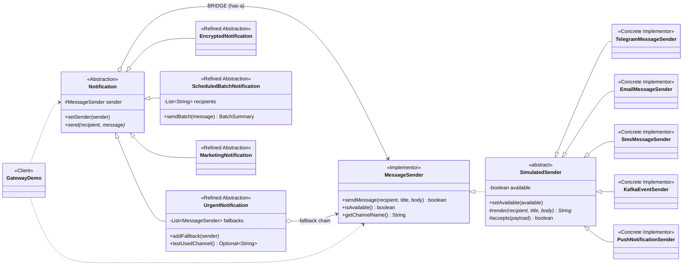

# Multi-Channel Notification Gateway — Bridge Pattern

Assignment 3, Software Design Patterns. Java 17, Maven, JUnit 5.

Notification **types** and delivery **providers** are two separate hierarchies joined by one
reference. Four types and five providers give twenty combinations, implemented by
**nine classes** instead of twenty.

| Abstraction (notification types) | Implementor (providers) |
|---|---|
| `UrgentNotification` | `TelegramMessageSender` — Markdown title |
| `EncryptedNotification` | `EmailMessageSender` — subject and signature |
| `ScheduledBatchNotification` | `SmsMessageSender` — max 160 characters |
| `MarketingNotification` *(added later)* | `KafkaEventSender` — publishes an event |
| | `PushNotificationSender` *(added later)* — 120-character banner |

## Run

```bash
./mvnw test                                                   # 18 tests
./mvnw package -DskipTests
java -cp target/classes kz.aitu.sdp.notify.GatewayDemo        # all six scenarios
```

```
5. Telegram unavailable -> fallback to SMS
    Telegram is unavailable, trying the next provider
    SMS      -> +77011111111 : Urgent notification: [URGENT] Power outage in the data centre
    delivered through: SMS
```

## The six questions

**1. What are the two independent dimensions?**
*What* is sent — urgent, encrypted, batch, marketing — and *how* it travels — Telegram,
Email, SMS, Kafka, Push. A new campaign type says nothing about transports, and a new
transport says nothing about message kinds.

**2. Where exactly is the Bridge?**
The field `protected MessageSender sender` in `Notification`, together with `setSender()`.
A notification **has a** provider instead of **being** one. Every refined abstraction reaches
the provider only through the three interface methods.

**3. Why is inheritance problematic here?**
Inheritance multiplies the two axes: `UrgentTelegramNotification`,
`UrgentEmailNotification`, `EncryptedTelegramNotification`, … N × M classes. Adding the fifth
provider to four notification types would mean four new classes, and the urgent logic would
be copied into each of them. Composition keeps the growth at N + M.

**4. What happens when a new provider is added?**
`PushNotificationSender` was added after the notifications were finished: one class
implementing `MessageSender`. No notification class was touched, and the new provider
immediately works with all four types and inside the fallback chain.
Verified by `newPushProviderWorksWithTheExistingNotifications`.

**5. What happens when a new notification type is added?**
`MarketingNotification` was added after the providers were finished: one class extending
`Notification`. No provider was touched, and the campaign runs over Email, Telegram, SMS and
Push. Verified by `newMarketingNotificationWorksWithTheExistingProviders`.

**6. Why is this Bridge rather than Adapter?**
Adapter is applied *after the fact*, to make an existing incompatible class usable — it
converts one interface into another. Here nothing is being converted: `MessageSender` was
designed up front as the implementation side of the gateway, and both hierarchies were built
to vary independently from the start. Adapter solves an incompatibility; Bridge prevents a
combinatorial explosion.

## Fallback without `instanceof`

```java
for (MessageSender candidate : chain()) {              // current sender, then the fallbacks
    if (!candidate.isAvailable()) continue;            // interface method
    if (candidate.sendMessage(recipient, TITLE, body)) // interface method
        return;
}
```

The notification never asks which class a provider is. A provider is skipped when it reports
itself unavailable **or** when it refuses the message — that is how an over-long SMS falls
back to Email in `fallbackAlsoTakesOverWhenTheProviderRefusesTheMessage`.

## Demo scenarios

1. `UrgentNotification` + Telegram
2. `EncryptedNotification` + Email (the demo decrypts the payload back)
3. `ScheduledBatchNotification` + SMS with a `Total / Successful / Failed` summary
4. Runtime switching Telegram → Email on the same object
5. Telegram unavailable → fallback to SMS
6. `MarketingNotification` + `PushNotificationSender`, then switched to SMS

## Tests

18 JUnit 5 tests (`./mvnw test`): successful delivery, unavailable provider, fallback by
availability and by refusal, SMS length limit, encryption and decryption, batch summary with
failures, runtime switching, the new provider, the new notification type, and the failure
case where no provider is left to try.

## UML

Source: [docs/uml/class-diagram.puml](docs/uml/class-diagram.puml)


