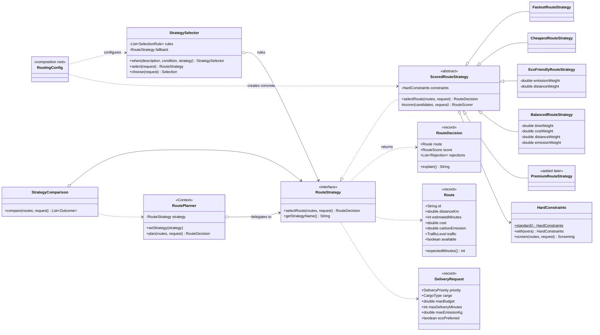
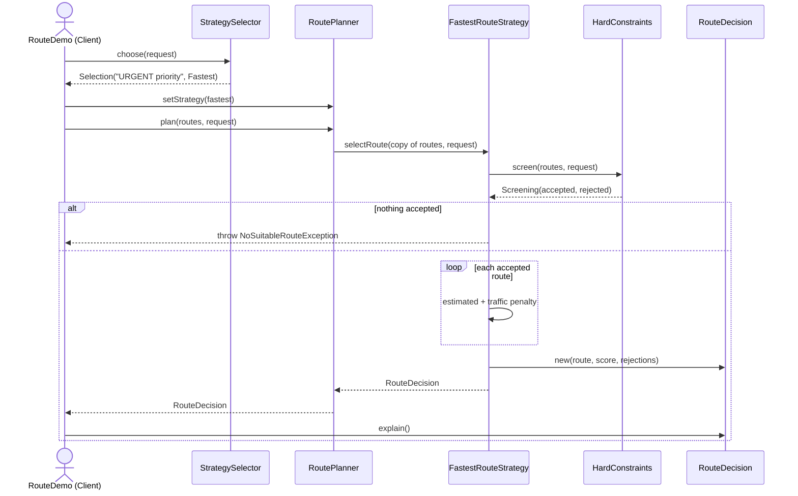

# Smart Delivery & Route Optimization Engine — Strategy Pattern

Assignment 5, Software Design Patterns. Java 17, Maven, JUnit 5.

A logistics company has eight ways to deliver an order from its Astana hub to the Expo district:
vans on the ring road or through the city centre, a motorbike courier on the expressway, an
electric van, a night truck, a cargo bike, a tunnel shortcut and a bridge that is closed for
repairs. Which one is "best" depends on the order — an urgent medical parcel wants time, an
economy parcel wants price, an eco order wants low CO2. Each of those answers is a separate
**strategy**, and the planner can switch between them while the program runs.

| Role | Class |
|---|---|
| Context | `planner/RoutePlanner` |
| Strategy | `strategy/RouteStrategy` |
| Concrete strategies | `FastestRouteStrategy`, `CheapestRouteStrategy`, `EcoFriendlyRouteStrategy`, `BalancedRouteStrategy`, `PremiumRouteStrategy` *(added later)* |
| Chooses the strategy | `planner/StrategySelector`, configured in `RoutingConfig` |
| Result with explanation | `strategy/RouteDecision` |

## Run

```bash
cd assignment5-strategy
./mvnw test                                                 # 23 tests
./mvnw package -DskipTests
java -cp target/classes kz.aitu.sdp.route.RouteDemo         # five scenarios
```

## Architecture

```
domain/       Location, Route, DeliveryRequest, TrafficLevel, CargoType, DeliveryPriority, Tariff
constraint/   RouteConstraint, HardConstraints, Screening, Rejection, NoSuitableRouteException
strategy/     RouteStrategy, ScoredRouteStrategy, five concrete strategies, RouteDecision, RouteScore
planner/      RoutePlanner (Context), StrategySelector, StrategyComparison
RoutingConfig the only class that names the concrete strategies and the selection rules
RouteDemo     the client; DemoData holds the eight routes and the requests
```

Every strategy goes through the same three steps, fixed in `ScoredRouteStrategy.selectRoute`
(Template Method inside the Strategy):

1. **Screen** the routes with the hard constraints — unavailable, over budget, past the deadline,
   prohibited for this cargo, over the emission limit. A rejected route is never scored, so it
   cannot win "simply because it has a good score".
2. **Score** what is left with the strategy's own formula — the only method a concrete strategy
   writes.
3. **Pick** the lowest score (ties: cheaper, then lower id) and return a `RouteDecision` that
   lists the steps of the score and the reason every other route was rejected.

If nothing passes step 1, the strategy throws `NoSuitableRouteException` carrying every
rejection. `null` is never returned.

### Design decisions

**`selectRoute` returns `RouteDecision`, not `Route`.** The assignment requires every strategy to
explain its result. A `Route` cannot say why it won; the strategy that chose it can. The record
holds the route, the `RouteScore` with its breakdown, and the list of `Rejection`s.

**The price formula is in `Tariff`, the scoring formulas are in the strategies.** The budget
constraint and the Cheapest strategy must see the same price, so the price is a domain rule.
How much a strategy *cares* about the price is its own decision.

**The traffic delay is on `Route`.** "Heavy traffic adds 40 %" is a fact about the road, and the
deadline constraint needs it. Fastest ranks by it, Premium doubles it, Balanced weighs it.

### Formulas

| Strategy | Score (lower wins) | Extra condition |
|---|---|---|
| Fastest | `estimatedMinutes + traffic penalty`, penalty = minutes × 0 / 0.15 / 0.40 for LOW / MODERATE / HEAVY | traffic level |
| Cheapest | `base cost + distanceKm × 35 + priority surcharge + cargo fee` | surcharge URGENT 1500, STANDARD 300; fee FRAGILE 400, MEDICAL 600, HAZARDOUS 1500 |
| Eco | `CO2 × 1.0 + distanceKm × 0.05` (weights configurable) | |
| Balanced | `Σ normalized(criterion) × weight` over time, cost, distance, CO2 | weights in 0..1, sum = 1.0, else `IllegalArgumentException` |
| Premium | `estimatedMinutes + 2 × traffic penalty` | worst case must still meet the deadline |

**Cost formula (Cheapest).** For request #102 the night truck R5 costs
`400 + 28 km × 35 + 0 + 0 = 1,380 KZT`. The surcharge and the fee are the same for every route
of one request, so they never change the ranking — they change whether a route fits the budget.
For #101 (URGENT, MEDICAL) the same truck would cost `1,380 + 1,500 + 600 = 3,480 KZT`.

**Why the eco score lives in the Eco strategy.** It is not a fact about the route but one opinion
of what a good route is: CO2 dominates, distance stands in for tyre wear, noise and road space and
separates two routes that emit about the same. Balanced weighs CO2 differently, Cheapest ignores
it. Putting the formula into `Route` would force that opinion on every strategy and every change
of the weights would touch the domain model.

**Balanced normalization.** Minutes, tenge, kilometres and kilograms cannot be added, so each is
scaled to 0..1 over the routes that passed the constraints: `(value − min) / (max − min)`, 0 = best
candidate, 1 = worst. The default weights are time 0.40, cost 0.30, distance 0.10, CO2 0.20.

## Example console output

```
1. Runtime strategy switching on one RoutePlanner, request #105
    Fastest   -> R2 (Expressway, motorbike courier)
    Cheapest  -> R5 (Night consolidated truck)
    Eco       -> R6 (City centre, cargo bike)
    Balanced  -> R7 (Tunnel shortcut, diesel van)
    the same planner object served all four strategies

2. Automatic strategy selection

  Request #101: URGENT, MEDICAL cargo, budget 10,000 KZT, deadline 40 min
  rule "URGENT priority" -> Fastest strategy
    Selected: R2 (Expressway, motorbike courier)
    Reason:
      Estimated time: 22 min
      Traffic penalty: +0 min (LOW traffic)
      Final time: 22 min, deadline 40 min
      Cost: 5,435 KZT
    R5 rejected: delivery deadline exceeded (55 min > 40 min)
    R6 rejected: delivery deadline exceeded (52 min > 40 min)
    R8 rejected: route is unavailable

  Request #104: STANDARD, FRAGILE cargo, budget 4,000 KZT, deadline 45 min
  rule "no rule matched, fallback" -> Balanced strategy
    Selected: R7 (Tunnel shortcut, diesel van)
    Reason:
      Time: 25 min -> 0.00 x 0.40 = 0.000
      Cost: 3,425 KZT -> 1.00 x 0.30 = 0.300
      Distance: 15.0 km -> 0.00 x 0.10 = 0.000
      CO2: 4.0 kg -> 0.58 x 0.20 = 0.117
      Score: 0.42
    R2 rejected: budget exceeded (4,035 KZT > 4,000 KZT); prohibited for FRAGILE cargo
    R5 rejected: delivery deadline exceeded (55 min > 45 min)
    R6 rejected: delivery deadline exceeded (52 min > 45 min)
    R8 rejected: route is unavailable

3. Strategy comparison mode
    DELIVERY REQUEST #105 (STANDARD, GENERAL cargo, budget 5,000 KZT, deadline 60 min)

    Strategy   Route                                 Time        Cost     CO2    Score
    Fastest    R2 (Expressway, motorbike courier)  22 min   3,635 KZT  3.1 kg    22.00
    Cheapest   R5 (Night consolidated truck)       55 min   1,680 KZT  7.5 kg  1680.00
    Eco        R6 (City centre, cargo bike)        52 min   1,890 KZT  0.1 kg     0.80
    Balanced   R7 (Tunnel shortcut, diesel van)    25 min   3,025 KZT  4.0 kg     0.36
    Premium    R2 (Expressway, motorbike courier)  22 min   3,635 KZT  3.1 kg    22.00

4. Failure scenarios
  no route satisfies the constraints:
    NoSuitableRouteException: Fastest found no suitable route for request #106:
      R1 rejected: budget exceeded (5,340 KZT > 3,000 KZT); delivery deadline exceeded (37 min > 30 min)
      R2 rejected: budget exceeded (6,335 KZT > 3,000 KZT); prohibited for HAZARDOUS cargo
      ...
  empty route list:
    NoSuitableRouteException: Fastest found no suitable route for request #105: no candidate routes were supplied
  balanced weights add up to 1.2:
    IllegalArgumentException: balanced weights must add up to 1.0, got 1.2000
  negative distance:
    IllegalArgumentException: distance must be positive: -3.0
  missing delivery priority:
    NullPointerException: delivery priority is required

5. PremiumRouteStrategy, added after the first four
    Fastest   -> R3 (City centre, diesel van)
  rule "URGENT with a premium budget" -> Premium strategy
    Selected: R1 (Ring road, diesel van)
    Reason:
      Estimated time: 32 min
      Forecast traffic penalty: +5 min (MODERATE traffic)
      Worst case, penalty doubled: 42 min, deadline 44 min
      Cost: 5,340 KZT
    R3 rejected: on-time guarantee broken (worst case 45 min > 44 min)
    ...
```

Note on #101: plain `min(estimatedMinutes)` would pick the tunnel R7 (18 min). With heavy
traffic it takes 25 min, so the expressway R2 (22 min) wins.

Different requests give different routes on the same data: #101 → R2, #102 → R5, #103 → R6,
#104 → R7, #107 → R1.

## The ten questions

**1. What problem does Strategy solve in this project?**
There is no single best route — it depends on the order. Without Strategy, every new way of
choosing would be one more `else if (mode.equals(...))` in the same method. With Strategy each
way of choosing is its own class behind one interface, and the planner can be given any of them.

**2. Where is the Context?**
`planner/RoutePlanner`. It holds `private RouteStrategy strategy`, has `setStrategy()` and
`plan()`, and `plan()` does nothing but pass a copy of the routes to `strategy.selectRoute()`.
No `instanceof`, no switch on names.

**3. Where is the Strategy interface?**
`strategy/RouteStrategy` — `RouteDecision selectRoute(List<Route>, DeliveryRequest)` and
`String getStrategyName()`. It returns `RouteDecision` instead of `Route` so the result can
explain itself (see *Design decisions*).

**4. What are the Concrete Strategies?**
`FastestRouteStrategy` (time + traffic), `CheapestRouteStrategy` (full tariff),
`EcoFriendlyRouteStrategy` (weighted CO2 and distance), `BalancedRouteStrategy` (four normalized
criteria with validated weights) and `PremiumRouteStrategy` (worst-case time, added later). All
extend `ScoredRouteStrategy`, which does the shared screening.

**5. Where is runtime strategy switching demonstrated?**
`RouteDemo.switchStrategiesAtRuntime()` — one `RoutePlanner` object, three `setStrategy` calls,
four different routes for the same request. Tested in
`PlannerTest.samePlannerChoosesDifferentRoutesAfterEachSwitch`. Scenarios 2 and 5 switch the
same way, driven by the selector.

**6. Why is this Strategy rather than simple if/else?**
With if/else every algorithm sits in one method: adding one means editing it, testing one means
going through all branches, and the planner knows every formula. Here each algorithm is a class
that can be tested alone (`StrategyTest`), configured (`BalancedRouteStrategy` weights), compared
with the others (`StrategyComparison` just loops over the list) and swapped at runtime. The
"which one" decision is also not an if/else: `StrategySelector` is an ordered list of
`condition → strategy` rules.

**7. How can a new Strategy be added?**
Write a class that extends `ScoredRouteStrategy` and implements `scorer()` (or implements
`RouteStrategy` directly), then register it in `RoutingConfig`. That is how
`PremiumRouteStrategy` was added in a separate commit:

| | Classes |
|---|---|
| New | `PremiumRouteStrategy`, `PremiumStrategyTest` |
| Changed | `RoutingConfig` (one constant, one selector rule, one list entry); `DemoData` and `RouteDemo` for the demo |
| Untouched | `RoutePlanner`, `RouteStrategy`, `ScoredRouteStrategy`, `StrategySelector`, `StrategyComparison`, `HardConstraints`, the four other strategies, all earlier tests |

The extra hard constraint Premium needs reaches the base class through
`HardConstraints.standard().with(ON_TIME_GUARANTEE)`, so even the constraint code did not change.

**8. What is the difference between Strategy and Bridge in the context of the previous assignment?**
Both use the same mechanics: an object holds an interface and the implementation can be replaced
at runtime (`Notification.setSender()` there, `RoutePlanner.setStrategy()` here). The intent is
different.
In the notification gateway there were **two hierarchies that both grow** — notification types and
delivery providers — and Bridge kept their combinations from multiplying (N + M classes instead
of N × M). It is a *structural* decision about how an abstraction and its implementation are
split for the life of the system.
Here there is **one** context that does not form a hierarchy at all — there are no
`UrgentRoutePlanner` and `EcoRoutePlanner` — and a family of **interchangeable algorithms** for
one task. Strategy is a *behavioural* decision: which algorithm runs for this request, chosen per
call by `StrategySelector`. Bridge answers "how do two independent dimensions combine",
Strategy answers "which way of solving this problem do we use now".

**9. Which SOLID principles are demonstrated?**
- **SRP** — `RoutePlanner` delegates, each strategy only ranks, `StrategySelector` only picks the
  strategy, `HardConstraints` only filters, `Tariff` only prices, `RouteDecision` only explains.
  "Strategy chooses *how* to solve the problem; StrategySelector decides *which* strategy is used."
- **OCP** — `PremiumRouteStrategy` was added without editing the planner, the selector, the base
  class or the other strategies (table above). New selection rules are `when(...)` calls.
- **DIP** — `RoutePlanner`, `StrategySelector` and `StrategyComparison` depend only on
  `RouteStrategy`. `RoutingConfig` is the single place that creates concrete strategies.
- **LSP** — `StrategyComparison` runs every strategy through the same loop; any of them can stand
  in for another.
- **ISP** — the strategy interface has two methods; constraints are a one-method interface.

**10. What limitation does the current architecture have?**
- `RoutePlanner` is mutable. Two threads calling `setStrategy` + `plan` on one shared planner can
  interleave; for concurrent dispatch each request needs its own planner, or the strategy should
  be passed to `plan()`.
- Balanced normalizes over the current candidates, so its score is relative: adding or removing
  an unrelated route can change the winner, and scores of two requests cannot be compared.
- Scores have different units per strategy (minutes, tenge, eco points, 0..1), so the
  comparison table only compares the routes, not the scores across rows.
- The routes are precomputed candidates with a traffic snapshot — there is no road graph or
  live traffic; the engine chooses among paths, it does not find them.
- Selector rules are first-match and live in code. Their order matters (the premium rule must
  come before the URGENT rule), and changing a rule means recompiling `RoutingConfig`.
- Tariff rates and traffic factors are constants, not configuration.

## Tests

23 JUnit 5 tests, `./mvnw test`:

```
Tests run: 6, Failures: 0, Errors: 0, Skipped: 0 -- in kz.aitu.sdp.route.StrategyTest
Tests run: 5, Failures: 0, Errors: 0, Skipped: 0 -- in kz.aitu.sdp.route.ConstraintTest
Tests run: 6, Failures: 0, Errors: 0, Skipped: 0 -- in kz.aitu.sdp.route.PlannerTest
Tests run: 4, Failures: 0, Errors: 0, Skipped: 0 -- in kz.aitu.sdp.route.FailureTest
Tests run: 2, Failures: 0, Errors: 0, Skipped: 0 -- in kz.aitu.sdp.route.PremiumStrategyTest
Tests run: 23, Failures: 0, Errors: 0, Skipped: 0
BUILD SUCCESS
```

| Required | Test |
|---|---|
| Fastest strategy | `StrategyTest.fastestCountsTheTrafficPenaltyNotOnlyTheFreeFlowTime` |
| Cheapest strategy | `StrategyTest.cheapestRanksByTheFullTariffNotByTheBaseCost` |
| Eco strategy | `StrategyTest.ecoPrefersLowEmissionAndSeparatesEqualEmissionByDistance` |
| Balanced strategy | `StrategyTest.balancedFollowsItsWeights`, `balancedScoresARouteBestOnEveryCriterionAsZero` |
| Explanation | `StrategyTest.decisionExplainsTheChoiceAndEveryRejection` |
| Runtime switching | `PlannerTest.samePlannerChoosesDifferentRoutesAfterEachSwitch` |
| Automatic selection | `PlannerTest.selectorMapsTheRequestToTheMatchingStrategy`, `selectorChecksRulesInOrderAndAcceptsNewRulesWithoutChanges` |
| Dynamic conditions | `PlannerTest.differentRequestsLeadToDifferentRoutes` |
| Hard constraint filtering | `ConstraintTest.unavailableProhibitedAndHighEmissionRoutesAreFilteredOut` |
| Budget restriction | `ConstraintTest.budgetRejectsTheFastestRoute` |
| Deadline restriction | `ConstraintTest.deadlineIsCheckedAgainstTheTimeWithTraffic` |
| No valid route | `ConstraintTest.noValidRouteThrowsWithTheReasonForEveryRoute` |
| Boundary case | `ConstraintTest.costExactlyAtTheBudgetAndTimeExactlyAtTheDeadlineAreAccepted` |
| Invalid Balanced weights | `FailureTest.invalidBalancedWeightsAreRejectedAtConstruction` |
| Failure scenarios | `FailureTest.emptyRouteListMeansNoSuitableRoute`, `routeWithNegativeCostOrDistanceCannotBeCreated`, `requestWithMissingDataCannotBeCreated` |
| Comparison of strategies | `PlannerTest.comparisonRunsEveryStrategyOnTheSameRequest`, `comparisonReportsStrategiesThatFindNothing` |
| New fifth strategy | `PremiumStrategyTest` (2 tests) |

### Failure handling

| Case | Where | Mechanism |
|---|---|---|
| No route passes the constraints | `ScoredRouteStrategy` | `NoSuitableRouteException` with every rejection |
| Empty route list | `ScoredRouteStrategy` | `NoSuitableRouteException` "no candidate routes were supplied" |
| Invalid Balanced weights | `BalancedRouteStrategy` constructor | `IllegalArgumentException` — the strategy never exists |
| Unavailable route | `HardConstraints.AVAILABLE` | rejected with a reason |
| Negative cost / distance | `Route` constructor | `IllegalArgumentException` |
| Missing request data | `DeliveryRequest` constructor | `NullPointerException` / `IllegalArgumentException` |

Invalid objects are refused when they are created; a business outcome ("no route fits") is an
exception the caller can catch and act on — `StrategyComparison` catches it and prints a row.

## UML

Sources: [docs/uml/class-diagram.puml](docs/uml/class-diagram.puml),
[docs/uml/sequence-diagram.puml](docs/uml/sequence-diagram.puml)

### Class diagram



### Sequence diagram — request #101, selected automatically



## Commit history

1. Initialize the delivery domain model
2. Add hard constraints and the no-suitable-route exception
3. Add the RouteStrategy abstraction with an explainable RouteDecision
4. Implement the fastest strategy with a traffic penalty
5. Implement the cheapest strategy with a visible cost formula
6. Add the eco-friendly strategy
7. Add the balanced weighted strategy
8. Add the RoutePlanner context and switch strategies at runtime
9. Add the strategy selector with an extensible rule list
10. Add the strategy comparison mode and the failure scenarios
11. Cover strategies, constraints, selection and failures with unit tests
12. Add PremiumRouteStrategy as a fifth strategy
13. Document the architecture, the UML and the ten README questions
